 

<!-- ホームページの URL が決まったら、下の 3 行のコメントを外して href を書き換えてください

-->

## 🌙 About

- 🏯 大阪を拠点に活動しています
- 🛡️ 情報セキュリティを「読む」だけでなく「体験する」教材として、Web で形にしています
- 🎐 線香花火や水の波紋など、ブラウザで遊べる小さな作品も作っています
- 🤖 Discord の翻訳 bot など、身近で役に立つツールも公開しています

## 🛠️ Tech

  
  
  
  
  
  
  
  

## ✨ Works

### 🛡️ セキュリティを「体験」で学ぶ

| 作品 | 内容 | |
| :-- | :-- | :-: |
| **[夜勤のSOC ｜ NIGHT SHIFT](https://makamaika.github.io/night-shift/)** | 一夜の SOC シフトで学ぶ、体験型インシデントレスポンス教材 | [repo](https://github.com/makamaika/night-shift) |
| **[APT ATLAS ｜ 影の図鑑](https://makamaika.github.io/apt-atlas/)** | 国家支援型サイバー攻撃グループ 39 組織のビジュアルカタログ | [repo](https://github.com/makamaika/apt-atlas) |
| **[Security Incident Stories](https://makamaika.github.io/security-incident-stories/)** | 2 つの実話を、紙芝居と判断ゲームでたどる Web アプリ | [repo](https://github.com/makamaika/security-incident-stories) |
| **[サイバー脅威の歴史タイムライン](https://makamaika.github.io/infosec-threat-history/)** | IPA「情報セキュリティ10大脅威 2026」を軸にした年表 | [repo](https://github.com/makamaika/infosec-threat-history) |
| **[ルーター脆弱性シミュレーター](https://makamaika.github.io/router-firmware-vuln-simulator/)** | 年代別ルーター・ファームウェアの脆弱性を学ぶ、完全オフラインの教材 | [repo](https://github.com/makamaika/router-firmware-vuln-simulator) |

### 🎐 ブラウザの小さな遊び

| 作品 | 内容 | |
| :-- | :-- | :-: |
| **[線香花火](https://makamaika.github.io/senko-hanabi/)** | ろうそくで火を点けて、最後まで見届ける小さな遊び | [repo](https://github.com/makamaika/senko-hanabi) |
| **[音の池](https://makamaika.github.io/oto-no-ike/)** | しずくの波紋で石を鳴らす、音のおもちゃ | [repo](https://github.com/makamaika/oto-no-ike) |
| **[月光書房](https://makamaika.github.io/gekko-shobo/)** | 彗星の夜にだけ現れる古書店。12 編の日本語短編集 | [repo](https://github.com/makamaika/gekko-shobo) |

### 🤖 Bot とツール

| 作品 | 内容 |
| :-- | :-- |
| **[discord-automatictranslation-v13](https://github.com/makamaika/discord-automatictranslation-v13)** | discord.js v13 で動く自動翻訳 bot |
| **[discord-ai-translate-v14](https://github.com/makamaika/discord-ai-translate-v14)** | Discord の AI 翻訳サンプル |
| **[twitch-comment-css](https://github.com/makamaika/twitch-comment-css)** | OBS で読み込む、Twitch コメント表示用のカスタム CSS |

## 📊 Stats

  

<picture>
  <source media="(prefers-color-scheme: dark)" srcset="https://raw.githubusercontent.com/makamaika/makamaika/output/github-contribution-grid-snake-dark.svg">
  
</picture>

